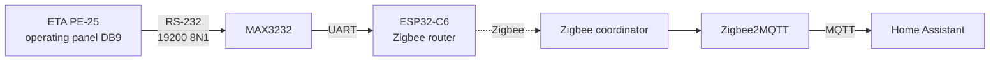
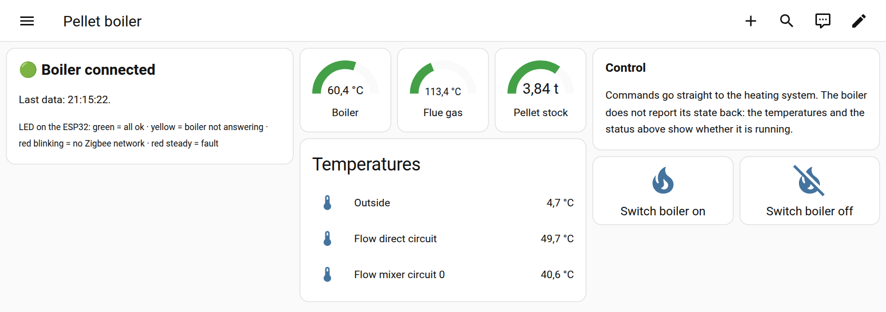

# ETA PE-25 → Zigbee → Home Assistant

Bring an older **ETA pellet boiler** (PE-25, built 2008, RS-232 only, no network) into Home Assistant, **over
Zigbee**, for boiler rooms with no Wi-Fi and no Ethernet.

A small **ESP32-C6** with a MAX3232 level shifter talks the boiler's serial protocol and joins your existing
Zigbee network as a router. Zigbee2MQTT hands the values to Home Assistant.

*The dashboard (English variant; the history graphs below these cards are not shown).*

## What you get

* **Temperatures:** boiler, flue gas, outside, flow (direct circuit and mixer circuit 0), plus buffer, hot water
  tank and external heat if your plant has them
* **Pellet stock** in tons (the controller's own counter)
* **Boiler on / off** commands (one-shot, with a confirmation dialog on the dashboard)
* **Fault flag** when the boiler sends a message (see the caveat below)
* **Status LED** on the board and a **status card** on the dashboard (connected / boiler silent / fault / offline)
* A ready-made **dashboard** (English and German) with gauges, history graphs and confirm buttons
* A **documented protocol**: most of what the boiler's serial port offers is described in [docs/protocol.md](docs/protocol.md)

The ESP32 is a Zigbee **router**, so it also strengthens your mesh. Values arrive every 30 s.

## What you need

| | |
|---|---|
| ETA boiler with the DB9 serial port on the operating panel | developed on a **PE-25**; other ETA models of the same controller family should be similar but are untested |
| ESP32-C6 board | tested: Waveshare ESP32-C6-DEV-KIT-N8 |
| MAX3232 module (3.3 V) with DB9, straight DB9 cable, mains USB charger | [docs/hardware.md](docs/hardware.md) |
| Zigbee coordinator with **Zigbee2MQTT** and Home Assistant | tested: Zigbee2MQTT 2.14.3, HA 2026.10 |
| ESP-IDF v5.5.6, Node 22+ (for the dashboard installer) | |

## Quick start

1. **Wire it** and run the loopback test: [docs/hardware.md](docs/hardware.md)
2. **Flash the firmware:** `cd firmware && idf.py build && idf.py -p /dev/ttyACM0 flash`
3. **Install the converter** `zigbee2mqtt/pe25_zb.mjs` into Zigbee2MQTT's `external_converters/` and restart it
4. **Pair** the board (permit join on, board near the coordinator)
5. **Install the dashboard:** `node homeassistant/install-dashboard.mjs homeassistant/dashboard.en.yaml`
6. **Plug the cable into the boiler.** The LED turns green, values appear within seconds

Details and options: [docs/setup.md](docs/setup.md). Something wrong? [docs/troubleshooting.md](docs/troubleshooting.md).

## Safety and limits, please read

* **Commands act on a real heating system.** *Boiler off* switches your boiler off. There is no confirmation
  from the boiler and no way to read its on/off state back. The dashboard asks for confirmation, the firmware does
  not. Build with *Allow commands* off if you only want to read.
* **Heating-mode commands (auto/day/night) are not reliable** on the test boiler: it showed "changed via SMS" but the
  mode did not change (probably the per-circuit *SMS Erlauben* setting). They are not on the dashboard.
* **The fault flag over-reports.** The boiler's `IM` frames carry information notices as well as errors: after every
  command you send, it announces "changed via SMS", which this firmware currently counts as a fault (for 30 minutes).
  A real error has never been observed yet. See [docs/protocol.md](docs/protocol.md#34-im--messages).
* **There is no summer / off mode** in this protocol.
* Sensors that are not installed read exactly 0. The **pellet stock is a counter** that you must correct at the
  controller after every delivery; it can be negative.
* Only an ETA **PE-25** (pellet boiler up to 30 kW, node `0x10`) was tested. Tested values were compared with
  the boiler display; nothing else was verified on other models.
* Use at your own risk, see the [license](LICENSE). This is an unofficial project and not affiliated with or
  endorsed by ETA Heiztechnik.

## Repository layout

| Path | Contents |
|---|---|
| [`firmware/`](firmware) | ESP-IDF project (Zigbee router, UART link, status LED) and the host-testable protocol library |
| [`zigbee2mqtt/`](zigbee2mqtt) | external converter `pe25_zb.mjs` with tests |
| [`homeassistant/`](homeassistant) | dashboards (EN/DE) and the installer script |
| [`tools/`](tools) | Zigbee channel scanner firmware, serial logger |
| [`docs/`](docs) | [protocol](docs/protocol.md), [hardware](docs/hardware.md), [setup](docs/setup.md), [troubleshooting](docs/troubleshooting.md), [development](docs/development.md) |

`make test` runs the protocol library tests, the converter tests and the dashboard checks without hardware.

## Background

ETA's PC software (ETA-SIM / remote control) talks to the controller's serial port with a small binary protocol:
framed messages, a checksum, cyclic data reports and a few commands. This project uses that protocol, nothing
else on the boiler is modified. The protocol notes in this repository are written from ETA's protocol excerpt
and from observations on a real boiler; ETA's own documents are not included.

## Contributing

Issues and pull requests are welcome, especially **verified values for other ETA controller types** (see
[docs/protocol.md](docs/protocol.md#5-monitor-list-indices)), boards other than the Waveshare one, and
confirmation of the heating-mode commands.

## License

MIT, see [LICENSE](LICENSE).
